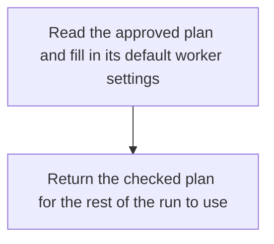

# Figure layout

Apply these rules to flowcharts, hand-drawn figures and their fallbacks. Keep
labels short enough to understand at a glance; put file paths and long code names
in the source-reference line beside the figure. Preserve any identity that the
reader needs to distinguish two nodes.

## Shared layout

Give labels padding and normal line height. Size each node from the wrapped text,
then place its arrows and neighbours. A roughly 320px figure is a starting point;
increase its height when the content needs it. Use a single column when two
figures would make their labels too small. Keep the complete text visible.

For HTML boxes, use actual wrapping text containers. This is a starting point,
not a requirement to reproduce a particular design:

```css
.figure-pair {
  display: grid;
  grid-template-columns: repeat(2, minmax(0, 1fr));
  gap: 1rem;
}
.figure, .diagram-node {
  min-inline-size: 0;
}
.diagram-node {
  max-inline-size: 100%;
  padding: .75rem 1rem;
  white-space: normal;
  overflow-wrap: anywhere;
  line-height: 1.4;
}
.figure svg {
  display: block;
  max-inline-size: 100%;
  block-size: auto;
}
@media (max-width: 52rem) {
  .figure-pair { grid-template-columns: minmax(0, 1fr); }
}
```

Avoid fixed node heights and inherited `white-space: nowrap` or preformatted
labels. `overflow: hidden`, ellipses, SVG `textLength` and smaller fonts conceal
layout problems. Expand or rearrange the figure instead. A wide graph scaled to
fit the screen can still have unreadable text even when nothing is clipped.

## Mermaid flowcharts

Use Markdown-string labels for automatic wrapping, with `markdownAutoWrap`
enabled and a suitable `flowchart.wrappingWidth`. Ordinary quoted labels do not
gain reliable wrapping simply from CSS on the surrounding `<pre>`.

This Mermaid 11 setup uses SVG text labels and starts with a wrapping width of
180; adjust the width and graph direction to suit the actual card:

```javascript
mermaid.initialize({
  startOnLoad: true,
  theme: "neutral",
  securityLevel: "strict",
  htmlLabels: false,
  markdownAutoWrap: true,
  flowchart: { useMaxWidth: true, wrappingWidth: 180 }
});
```



Markdown strings can also contain a deliberate newline at a natural phrase break.
Use the same treatment for long edge or group labels. Confirm the actual Mermaid
version supports the chosen settings; copy the setup into the upstream report's
existing Mermaid import rather than adding a second renderer.

Reference: official [Markdown-string syntax](https://mermaid.js.org/syntax/flowchart.html#markdown-strings),
[flowchart wrapping settings](https://mermaid.js.org/config/schema-docs/config-defs-flowchart-diagram-config.html#wrappingwidth),
and [automatic wrapping](https://mermaid.js.org/config/schema-docs/config.html#markdownautowrap).

## Hand-drawn SVG

SVG `<text>` does not wrap like an HTML paragraph. Choose explicit lines and emit
one `<tspan>` per line, or use wrapping HTML boxes with separate SVG connectors.
For explicit lines, measure their rendered width using the actual font and size;
each line must fit inside the node after left/right padding. Measure again after
changing the wording or font. A character-count estimate is a fallback, not proof
of fit.

Set node height from line count, line height and top/bottom padding. Keep every
line inside the rectangle. Reposition connectors and neighbouring nodes from the
new dimensions; adding line breaks without growing a short box can clip text
vertically or place it over an arrow. Escape generated labels as text.

## Check the finished report

When a browser renderer is available:

1. Wait for fonts and Mermaid rendering to finish. Check the saved HTML itself,
   including both the Mermaid version and any static fallback.
2. Inspect every before/after figure at a desktop width around 1280px and a narrow
   width around 390px. Those are useful probes, not the only supported sizes.
3. Confirm labels wrap into complete readable lines, stay inside their nodes,
   and leave space for arrows and adjacent nodes. Check narrow figures at normal
   zoom; a full-page screenshot can hide tiny text.
4. Use browser measurements where useful: compare HTML label content with its
   container and SVG text bounds with the padded node rectangle. These checks
   supplement looking for overlaps, cropped lines and broken connectors.
5. Fix the layout and recheck affected figures before delivering. Claim a visual
   check only for the rendering and widths actually inspected.

When no browser renderer is available, prefer wrapping HTML boxes or explicit
multiline SVG labels with generous padding and expandable height. Validate markup,
line layout, source links and fallback content, and identify the missing visual
check in the delivery note. Do not infer successful wrapping from valid HTML or
Mermaid syntax alone.
